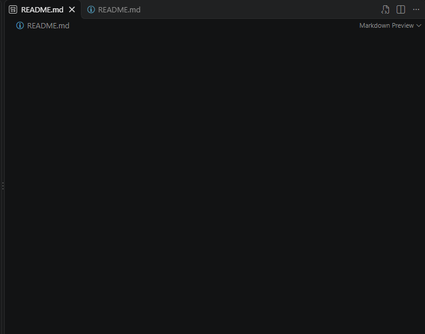
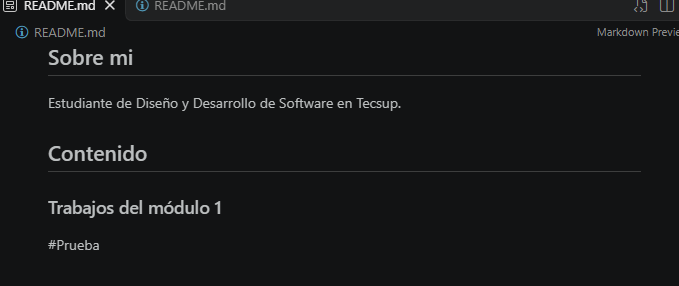
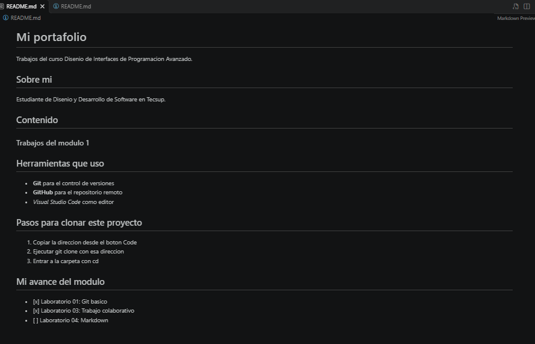

# Mi portafolio
 
Trabajos del curso Disenio de Interfaces de Programacion Avanzado.
 
## Sobre mi
 
Estudiante de Disenio y Desarrollo de Software en Tecsup.
 
## Contenido
 
### Trabajos del modulo 1

## Herramientas que uso
 
- **Git** para el control de versiones
- **GitHub** para el repositorio remoto
- *Visual Studio Code* como editor
 
## Pasos para clonar este proyecto
 
1. Copiar la direccion desde el boton Code
2. Ejecutar git clone con esa direccion
3. Entrar a la carpeta con cd
 
## Mi avance del modulo
 
- [x] Laboratorio 01: Git basico
- [x] Laboratorio 03: Trabajo colaborativo
- [ ] Laboratorio 04: Markdown

## Enlaces útiles
 
- [Guía oficial de Markdown](https://www.markdownguide.org/)
- [Mi perfil de GitHub](https://github.com/AlexLauracio)
 
## Captura de mi trabajo
 

## Resumen de laboratorios

| Laboratorio | Tema | Estado |
| :--- | :--- | :---: |
| Lab 01 | Git básico y comandos | Completado |
| Lab 03 | Trabajo colaborativo | Completado |
| Lab 04 | Markdown y documentación | En proceso |
